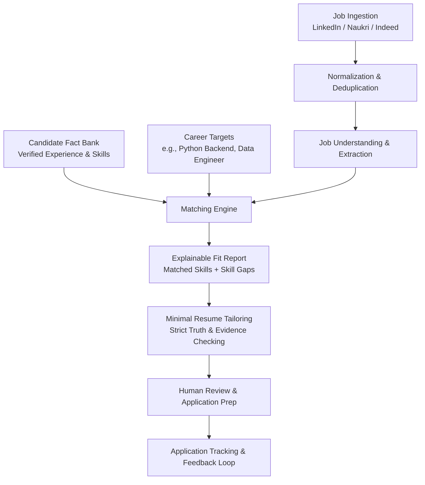

# Career Copilot 🚀

> **A personal-first, intelligent AI career assistant designed to discover high-match jobs, bridge skill gaps, tailor honest resumes, and manage the end-to-end application lifecycle.**

---

## 💡 What is Career Copilot?

Job searching today is tedious, fragmented, and noisy. Candidates spend hours scouring multiple job portals, copy-pasting resumes, dealing with misleading keyword matches, and trying to track where they applied. Meanwhile, generic AI tools often hallucinate or invent fake experience on resumes.

**Career Copilot** is built to solve this. It acts as your personal AI career co-pilot that:
1. **Understands your genuine background**: Maintains a verified fact bank of your actual skills and projects—never inventing fake experience.
2. **Supports multiple career goals**: Lets you target diverse roles simultaneously (e.g., *Python Backend Engineer*, *AWS Data Engineer*, *Cloud Solutions Developer*).
3. **Finds & deduplicates jobs**: Aggregates job postings across platforms (LinkedIn, Naukri, Indeed), removes duplicate listings, and filters out stale jobs.
4. **Performs deep, explainable matching**: Shows you exactly *why* a job fits, which skills you already have, and where your gaps are.
5. **Tailors resumes with integrity**: Produces minimally adapted, JD-specific resumes highlighting relevant facts while preserving your core identity.
6. **Assists with applications & tracks outcomes**: Provides human-in-the-loop application assistance and monitors results over time to help you learn which roles work best.

---

## 🎯 Core Principles

| Principle | What It Means |
| :--- | :--- |
| **Quality over Quantity** | We optimize for finding the *right* high-fit opportunities, not for blasting 1,000 low-quality spam applications. |
| **Zero Resume Hallucination** | The system will **never** invent employers, metrics, or skills. Only verified experience is included in generated resumes. |
| **Candidate in the Driver's Seat** | Automation handles repetitive search and extraction, but all critical actions (skill confirmation, resume review, application submission) remain under your explicit control. |
| **Local-First & Low-Cost** | Runs locally with open-source tools (FastAPI, PostgreSQL + pgvector, Playwright) and intelligent staged filtering to minimize expensive LLM API costs. |

---

## 🛠️ How It Works



### 1. Candidate Fact Bank & Skill States
Instead of treating your resume as a flat PDF, Career Copilot breaks it down into structured, proven facts (experiences, achievements, projects, metrics). Every skill has a clear state:
- `VERIFIED` — Confirmed by your resume/experience (safe to put on tailored resumes).
- `CLAIMED` / `LEARNING` — Skills you know or are actively studying, but not yet verified as production experience.
- `TARGET` — Skills required by target jobs that you plan to learn.
- `NOT_RELEVANT` — Skills you do not wish to use.

### 2. Multi-Role Career Targets
You aren't restricted to a single rigid job title. You can set up multiple search profiles with natural language goals (e.g., *"I want backend Python or cloud data engineering roles, remote or hybrid in Bengaluru"*), and the system expands them into related industry roles.

### 3. Smart Job Ingestion & Deduplication
Career Copilot ingests listings from major platforms, cleans and normalizes descriptions, and eliminates duplicates even if the same job is posted across multiple sites with slightly different titles.

### 4. Multi-Stage Intelligent Matching
To keep processing fast and low-cost, matching runs through an intelligent funnel:
1. **Hard Filters**: Location, salary, work mode, minimum experience.
2. **Skill Matrix**: Direct comparison against your verified skill bank.
3. **Semantic Similarity**: Vector embeddings (`pgvector`) to find conceptual overlap.
4. **Deep LLM Reasoning**: Applied only to shortlisted candidates to give you an explainable breakdown of fit, gaps, and transferable skills.

### 5. Honest Resume Tailoring
When applying for a specific role, Career Copilot selectively highlights your most relevant verified achievements and aligns terminology with the job description. It enforces strict truth-validation rules before generating the final resume.

### 6. Application Tracking & Learning Loop
Keep a clear log of every application (`DISCOVERED` $\to$ `SHORTLISTED` $\to$ `APPLIED` $\to$ `INTERVIEW` $\to$ `OFFER`). Over time, the system analyzes which role types and resume variants generate the best response rates.

---

## 🏗️ Architecture & Tech Stack

Career Copilot is designed as a **Modular Monolith**—clean, isolated internal domain boundaries without the overhead and complexity of microservices.

- **Backend**: Python 3.11+, FastAPI, Pydantic v2, SQLAlchemy 2.0 (async), Alembic
- **Database & Vectors**: PostgreSQL 16 with `pgvector` extension
- **LLM Layer**: Multi-provider gateway (Gemini, OpenRouter, Ollama) with staged cost-optimized routing
- **Browser Automation**: Playwright (for session-assisted job discovery & form prep)
- **Containerization**: Docker & Docker Compose for one-command local startup
- **Testing**: pytest with unit and integration coverage

---

## 📁 Repository Structure

```text
Career_copilot/
├── docs/                                   # Persistent project memory & trackers
│   ├── PROJECT.md                          # Stable architecture & overview
│   ├── BUILD_PLAN.md                       # Complete engineering task breakdown
│   ├── ROADMAP.md                          # Phase-by-phase completion checklist
│   ├── CURRENT_TASK.md                     # Active task tracker
│   ├── DECISIONS.md                        # Architecture Decision Records (ADRs)
│   └── SESSION_LOG.md                      # Development session history
├── .agents/skills/                         # Antigravity agent execution skills
├── backend/
│   ├── app/
│   │   ├── api/                            # REST API routes (v1)
│   │   ├── core/                           # Config, database, logging, exceptions
│   │   ├── candidate/                      # Candidate profile & fact bank
│   │   ├── career_profiles/                # Career targets & role expansion
│   │   ├── jobs/                           # Ingestion, deduplication, normalization
│   │   ├── matching/                       # Match scoring & gap analysis
│   │   ├── resumes/                        # Master resume & minimal tailoring
│   │   ├── applications/                   # Application tracking & state machine
│   │   ├── browser/                        # Playwright automation adapter
│   │   └── llm/                            # Provider-agnostic LLM gateway
│   ├── alembic/                            # DB migrations
│   └── tests/                              # Unit & integration tests
├── docker-compose.yml                      # PostgreSQL + pgvector local stack
├── pyproject.toml                          # Project dependencies & metadata
└── README.md                               # Project documentation
```

---

## 🗺️ Development Roadmap

- [ ] **Phase 0: Foundation** — Project setup, Docker, PostgreSQL + pgvector, FastAPI skeleton, health checks & tests.
- [ ] **Phase 1: Candidate Intelligence** — Candidate profile, resume fact bank, and verified skill taxonomy.
- [ ] **Phase 2: Career Targets** — Multiple search profiles and natural-language role expansion.
- [ ] **Phase 3: Job Pipeline** — Multi-source ingestion, normalization, deduplication, and freshness tracking.
- [ ] **Phase 4: Job Understanding** — Structured requirement and skill extraction from job descriptions.
- [ ] **Phase 5: Matching Engine** — Multi-stage matching funnel, skill gap detection, and match explanations.
- [ ] **Phase 6: Resume Intelligence** — Master resume management, targeted tailoring, and truth-checking validator.
- [ ] **Phase 7: Browser Automation** — Playwright integration and platform adapters (LinkedIn, Naukri, Indeed).
- [ ] **Phase 8: Application Assistance** — Form autofill assistance, human review handoff, and application preparation.
- [ ] **Phase 9: Tracking & Analytics** — Application status tracking, outcome metrics, and feedback learning loop.
- [ ] **Phase 10: Hardening & Stabilization** — Cost controls, security validation, and full end-to-end integration.

---

## 🚀 Quick Start (Local Setup)

### Prerequisites
- Python 3.11+
- Docker & Docker Compose
- Node.js (optional, for browser tooling)

### 1. Clone & Configure
```bash
cp .env.example .env
# Edit .env with your local settings and API keys (if using LLM features)
```

### 2. Start PostgreSQL with pgvector
```bash
docker compose up -d
```

### 3. Install Backend Dependencies & Run Migrations
```bash
cd backend
pip install -e .
alembic upgrade head
```

### 4. Run the Backend API
```bash
uvicorn app.main:app --reload --port 8000
```
- API Documentation: [http://localhost:8000/docs](http://localhost:8000/docs)
- Health Check: [http://localhost:8000/api/health](http://localhost:8000/api/health)

---

## 📄 License
This project is open-source under the MIT License.
